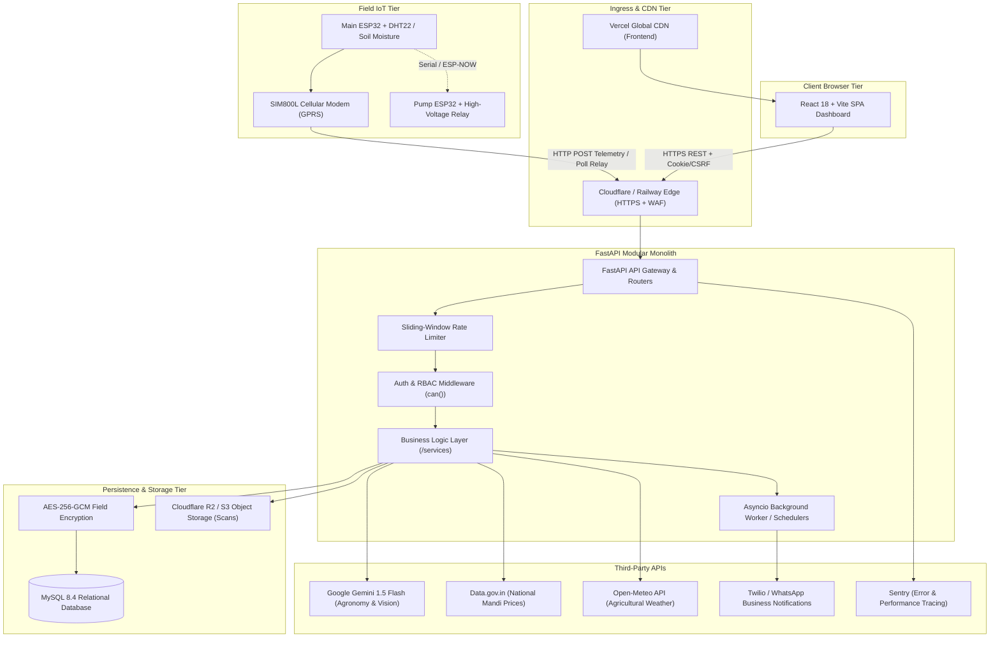

# CropConnect: System Architecture Document (Layer 2)

## 1. Component Diagram



---

## 2. Stack Choices & Alternatives Evaluated

| Layer | Chosen Technology | Evaluated Alternative | Rationale for Rejection |
|---|---|---|---|
| **Backend Framework** | **FastAPI (Python 3.12)** | Django / Node.js (Express) | Django is heavier with excessive boilerplate for IoT streaming; Express lacks Python's native AI/ML libraries (YOLO, OpenCV, NumPy) required for on-device plant disease inference. |
| **Relational Database** | **MySQL 8.4** | PostgreSQL / MongoDB | MySQL 8.4 provides battle-tested performance, native JSON document capabilities, low operational overhead on Railway, and straightforward backup/restore pipelines. MongoDB was rejected for lack of relational integrity constraints between farmers, pumps, and telemetry. |
| **Frontend Framework** | **React 18 + Vite** | Next.js (SSR/App Router) | CropConnect is an authenticated, real-time telemetry dashboard. Client-side Vite SPA allows effortless zero-cost static hosting on Vercel, offline PWA caching, and instantaneous build times without Node server maintenance. |
| **Styling & UI** | **Tailwind CSS + Radix UI** | Material UI (MUI) / CSS Modules | MUI has heavy bundle overhead and generic "Google template" appearance. Tailwind with custom earthen palette tokens gives a distinct, accessible, high-performance interface. |
| **Object Storage** | **Cloudflare R2 / S3** | Local disk storage | Local disk on ephemeral PaaS containers (Railway/Docker) loses files on redeploy; R2 offers S3-compatible private signed URLs with zero egress fees. |
| **IoT Connectivity** | **SIM800L Cellular GPRS** | LoRaWAN / WiFi | Indian rural agricultural fields rarely have ubiquitous farm-wide WiFi. SIM800L provides reliable cellular connectivity on affordable 2G/GPRS plans with nationwide carrier coverage. |

---

## 3. Repository Folder Structure

```
Cropconnect-main/
├── cropconnect-backend/            # FastAPI Backend Application
│   ├── app.py                      # App factory, middleware, lifecycle
│   ├── config.py                   # Pydantic Settings & env validator
│   ├── logging_config.py           # Structured JSON logger with request_id
│   ├── security_crypto.py          # AES-256-GCM encryption & PBKDF2 hashing
│   ├── migrate_db.py               # Automated SQL migration runner
│   ├── models.py                   # Pydantic schemas & DTOs
│   ├── db/                         # Database adapters & migrations
│   │   ├── migrations.py           # Schema evolution logic
│   │   ├── mongodb.py / mysql.py   # Connection pooling & pinging
│   │   └── repositories.py         # Data access object layer
│   ├── routers/                    # Thin HTTP controllers
│   │   ├── auth.py                 # Signup, login, password reset, DPDP export
│   │   ├── public.py               # Health checks (/api/health, /api/health/live)
│   │   ├── sensors.py              # Telemetry ingest & history
│   │   ├── pumps.py                # Relay commands & schedules
│   │   ├── ai.py                   # Gemini & agronomy advice
│   │   ├── market.py               # Mandi price feeds & profit calculator
│   │   └── weather.py              # Open-Meteo forecasts
│   ├── services/                   # Dedicated business logic domain layer
│   │   ├── auth_service.py         # Session & cookie logic
│   │   ├── permissions.py          # Central RBAC can(user, action, resource)
│   │   ├── rate_limit.py           # Sliding-window rate limiter
│   │   ├── sensor_service.py       # Telemetry parsing & validation
│   │   ├── market_service.py       # Mandi caching & aggregation
│   │   └── whatsapp_service.py     # Background alert scheduler
│   ├── tests/                      # Unit & integration test suites
│   └── scripts/                    # Maintenance, backup, and restore scripts
│
├── cropconnect-frontend/           # React 18 + Vite SPA
│   ├── index.html                  # HTML entry point with PWA meta
│   ├── vite.config.js              # Vite bundler configuration
│   ├── src/
│   │   ├── App.jsx                 # Client router & auth boundary
│   │   ├── index.css               # Design system tokens & global rules
│   │   ├── components/
│   │   │   ├── ui/                 # Base components (Button, Input, Skeleton, Modal, Table)
│   │   │   └── dashboard/          # Feature widgets (SensorPanel, PumpPanel, MarketPanel)
│   │   ├── pages/                  # Page screens
│   │   │   ├── LandingPage.jsx     # Marketing & conversion
│   │   │   ├── Dashboard.jsx       # Real-time farmer cockpit
│   │   │   ├── CropPlanner.jsx     # Rotation & advisory planner
│   │   │   ├── CropScanPage.jsx    # Leaf disease photo upload
│   │   │   └── DesignSystemPage.jsx# /design living component catalog
│   │   └── lib/                    # API client, error handling, thresholds
│
├── docs/                           # Architecture, decisions, runbooks
│   ├── decisions/                  # Architecture Decision Records (ADRs)
│   └── runbooks/                   # Operational runbooks (backups, deploy, rollback)
├── .github/workflows/ci.yml        # Automated CI/CD pipeline
├── docker-compose.yml              # Local containerized developer environment
├── CLAUDE.md / AGENTS.md           # Project memory & agent rules
└── README.md                       # Quick-start & operational documentation
```

---

## 4. Where Background Jobs Run and How
1. **In-Process Asyncio Background Workers**:
   - Long-lived tasks (e.g. WhatsApp notification scheduler, telemetry threshold monitor) run as managed asyncio tasks inside FastAPI’s lifespan context manager in `app.py`.
   - On shutdown, `lifespan` signals a graceful cancellation event (`whatsapp_stop.set()`) and awaits task completion before terminating the process.
2. **Idempotency & Retries**:
   - Each background alert task checks processed event IDs to prevent duplicate alerts.
   - Retries use exponential backoff with jitter and a maximum attempt limit of 3.
3. **Future Scaling (Phase 2)**:
   - When background job volume exceeds 50,000 tasks/day, jobs will migrate to Redis + Celery / BullMQ workers deployed on Railway.

---

## 5. Third-Party Services & Monthly Cost Analysis

| Service | Purpose | Cost at Launch (1,000 Farms) | Cost at 10x Scale (10,000 Farms) |
|---|---|---|---|
| **Railway** | FastAPI Backend + MySQL Database hosting | $10 - $20 / month | $80 - $120 / month |
| **Vercel** | Frontend React SPA CDN hosting | $0 (Hobby / Free tier) | $20 / month (Pro) |
| **Google Gemini API** | Multimodal crop diagnostics & chat | $5 - $15 / month (Pay-per-use) | $50 - $120 / month |
| **Data.gov.in API** | National mandi commodity price data | $0 (Public Open Data) | $0 (Cached locally) |
| **Open-Meteo** | Weather forecast API | $0 (Non-commercial / Low volume) | $15 / month (Commercial tier) |
| **Sentry** | Error tracking & APM tracing | $0 (Developer tier) | $26 / month (Team tier) |
| **Twilio / WhatsApp** | Transactional irrigation alerts | $15 / month | $120 / month |
| **Total Estimated Cost** | — | **~$30 - $50 / month** | **~$280 - $400 / month** |

---

## 6. The 3 Riskiest Decisions in this Architecture
1. **SIM800L 2G/GPRS Cellular Connectivity**:
   - *Risk*: Telecom carriers in some regions are refarming 2G spectrum in favor of 4G/5G, leading to coverage blackouts.
   - *Mitigation*: The hardware abstraction layer allows drop-in replacement with 4G LTE-M (SIM7600) modules with identical AT command sets.
2. **Modular Monolith vs Microservices**:
   - *Risk*: Backend components share process space; a memory leak in image processing could impact telemetry ingestion.
   - *Mitigation*: Heavy vision inference uses pre-warmed lightweight ONNX/YOLO models with explicit memory cleanup, and can be split into a separate worker container via Railway if CPU pressure increases.
3. **Client-Side SPA Architecture**:
   - *Risk*: Requires API connectivity to render dynamic telemetry; initial bundle download on slow 2G connections.
   - *Mitigation*: Vite code splitting, PWA service worker offline caching, and lightweight bundle footprint (< 150KB gzip).
